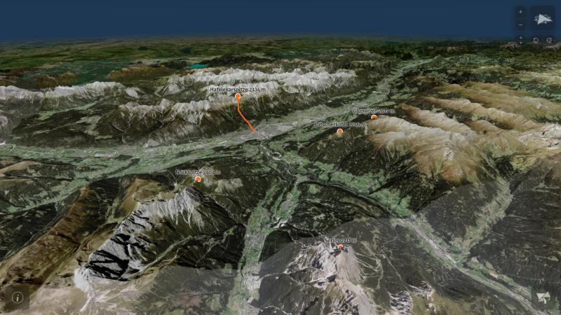
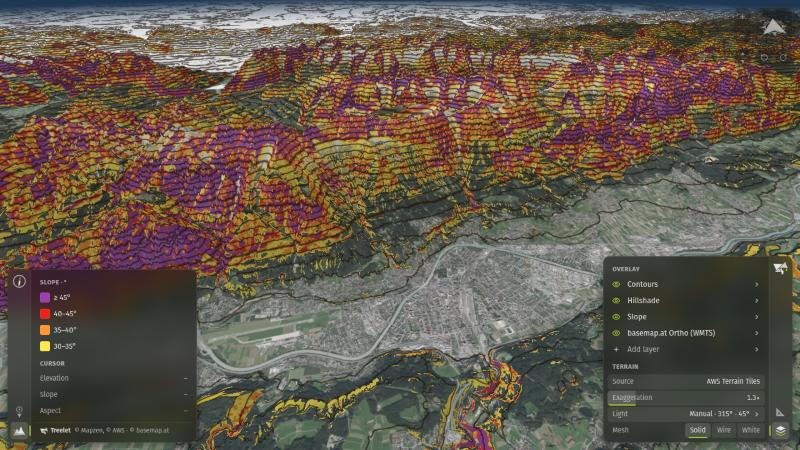
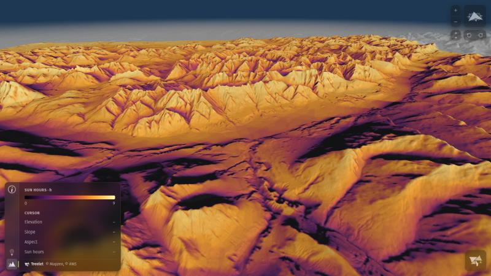
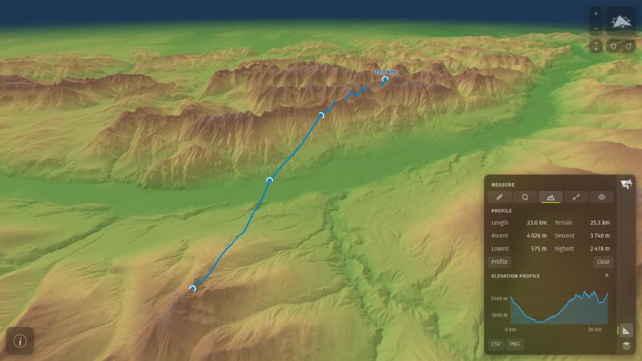

[](https://www.npmjs.com/package/@geozelot/treelet)
[](https://github.com/geozelot/treelet/actions/workflows/ci.yml)
[](./LICENSE)
[](https://bundlephobia.com/package/@geozelot/treelet)

#  Treelet.js

#### A GPU-driven, lightweight 3D elevation & overlay mapping engine for web-based terrain exploration and beautiful landscapes - inspired by the simplicity of [Leaflet.js](https://leafletjs.com/) and powered by [Three.js](https://threejs.org/).

[](https://geozelot.github.io/Treelet/)

**[Live demo](https://geozelot.github.io/Treelet/)** · **[Documentation](docs/README.md)** · **[API reference](https://geozelot.github.io/Treelet/api/)** · **[Changelog](CHANGELOG.md)**

Treelet turns elevation tiles into a continuous 3D surface you can fly over, and colors it with a stack of *coats*: imagery, terrain analyses and your own rasters, blended over each other. GeoJSON overlays, measuring tools and a set of slim controls come with it, so a few lines get you from a DEM to an explorable, analysable landscape - with your own data or global-coverage sources.

## Features

- **Terrain from any DEM tiles** - XYZ (slippy map, TMS), WMTS and WMS (plugin) sources; Terrain-RGB, Terrarium or your own decoder.
- **A stack of coats** - one imagery layer and any number of analyses over it, each with opacity and blend mode: elevation, slope, aspect, curvature, contours, water level, hillshade and terrain-cast shadows. Color ramps (or your own stops and classes) come with legends; a custom analysis is a GLSL snippet and a parameter schema.
- **Region analyses in a worker** - viewshed (with Earth curvature), hours of sun on a date, sky-view factor and topographic position index, shown as coats; your own value grids or images as raster layers.
- **GeoJSON overlays** - points, lines and polygons draped on the terrain, with labels; polygon fills lie exactly on the ground.
- **Measuring** - distance and area along the terrain, elevation profiles with CSV and PNG export, line of sight, terrain sampling at any point.
- **Ready-made controls** - a compass with navigation, a hub for the layers and the tools, an info box with legends, a cursor readout and the credits; light and dark, keyboard and touch friendly, full width on phones.
- **Fast and smooth** - every visible tile in one instanced draw call, screen-space LOD with geomorphing, seamless relief across tile edges, fetching and decoding in workers, and rendering only when something changes.

| [](assets/screenshots/avalanche.jpg) | [](assets/screenshots/sun-hours.jpg) | [](assets/screenshots/profile.jpg) |
|:---:|:---:|:---:|
| Slope classes and contours over an orthophoto, with the layers and the legend open | Hours of direct sun on the winter solstice, computed in a worker | An elevation profile drawn with the measuring tools |

## Quick start

```bash
npm install @geozelot/treelet three
```

```ts
import { Treelet, XYZSource } from '@geozelot/treelet';

const map = Treelet.map('map', { initCenter: { lng: 11.39, lat: 47.27 }, initZoom: 10 });

// The terrain: elevation tiles (AWS Terrain Tiles, no key needed)
map.addBaseLayer({
  layerName: 'AWS Terrain',
  layerSource: new XYZSource({ url: 'https://s3.amazonaws.com/elevation-tiles-prod/terrarium/{z}/{x}/{y}.png', maxZoom: 15 }),
  decoder: 'terrarium',
});

// Imagery under the map's hillshade, and an analysis over it
const osm = map.addDrapeLayer({
  layerName: 'OpenStreetMap',
  layerSource: new XYZSource({ url: 'https://tile.openstreetmap.org/{z}/{x}/{y}.png', maxZoom: 19, attribution: '© OpenStreetMap contributors' }),
});
map.activateDrapeLayer(osm);
map.addAnalysisLayer({ analysis: 'contours', params: { interval: 50 } });

map.start();
```

Without a bundler, the standalone build works from a `<script>` tag; its global `Treelet` holds the library's exports:

```html
<script src="https://unpkg.com/@geozelot/treelet/dist/treelet.cdn.standalone.js"></script>
<script>
  const map = Treelet.Treelet.map('map', { initCenter: { lng: 11.39, lat: 47.27 }, initZoom: 10 });
  // … the same calls as above, with Treelet.XYZSource
</script>
```

[Getting started](docs/getting-started.md) has the details.

## Bundles

| File | Format | Three.js | For |
|---|---|---|---|
| `treelet.es.js` | ESM | peer dependency | bundlers (Vite, Webpack, Rollup) - ~145 KB gzipped |
| `treelet.cdn.standalone.js` | IIFE | included (tree-shaken) | a `<script>` tag or a CDN, no dependencies - ~235 KB gzipped |
| `treelet.worker.js` | ESM worker | - | optional: a self-hosted worker for strict Content-Security-Policies (`workerUrl`) |

Both bundles start their tile worker from a `blob:` URL, so nothing else needs to be served. The package is side-effect free and safe to import during server-side rendering.

## Documentation

- [Getting started](docs/getting-started.md) - installation, the script tag, bundles and browser support
- [The map](docs/map.md) - options, the controls, view and camera, events
- [Terrain](docs/terrain.md) - base layers, tile sources and elevation decoders
- [Coloring the ground](docs/coats.md) - the coat stack, imagery, analyses, color ramps, light and shadow
- [Region analyses and rasters](docs/region-analyses.md) - viewshed, sun hours, sky view, TPI and your own rasters
- [Overlays and tools](docs/overlays-and-tools.md) - GeoJSON overlays, terrain inspection and the measuring tools
- [API reference](docs/reference.md) - the main types and the low-level exports, with the [generated reference](https://geozelot.github.io/Treelet/api/) for every class and method
- [Changelog](CHANGELOG.md) - with a [migration guide from 0.3](CHANGELOG.md#migrating-from-03)

## Browser support

Modern browsers with WebGL2, module Web Workers and OffscreenCanvas: Chrome and Edge 80+, Firefox 105+, Safari 16.4+.

## License

[MIT](LICENSE)
